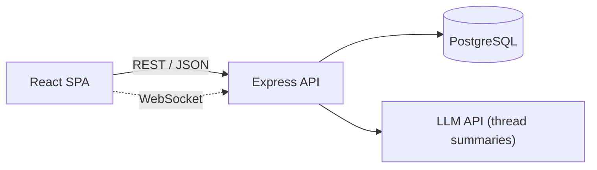
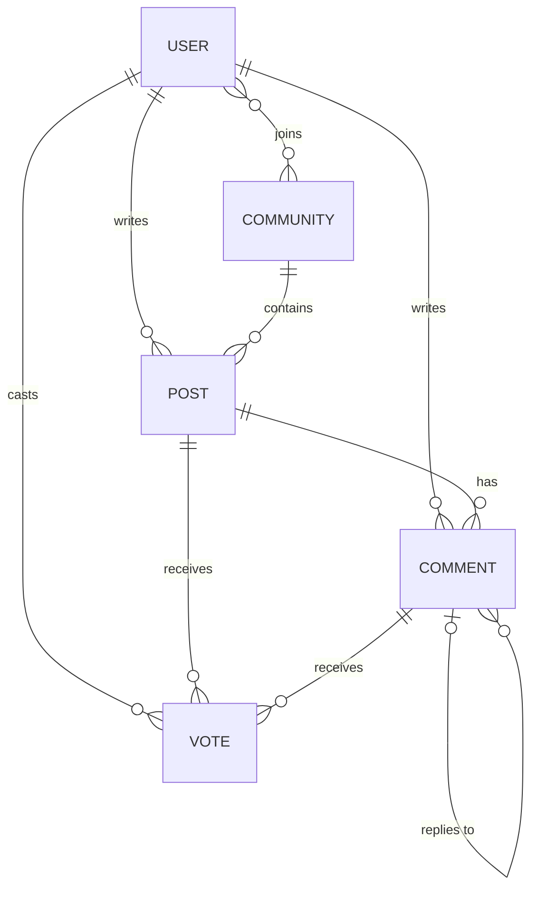

# Upthread

A full-stack discussion platform: topic-based communities, threaded conversations and community-ranked content. Reddit-style, built from scratch.

   > 🚧 **Early development** · v0.2 (responsive styling) in progress · see the [roadmap](#roadmap)

## Overview

Upthread is designed around topic-based communities where people share posts and links and discuss them in nested threads. Votes feed a time-decayed "hot" ranking, so fresh, well-received content rises to the top.

## Scope (v1.0)

- **Communities:** create, join, browse
- **Posts:** text and links, with upvotes and downvotes
- **Threads:** nested comments of arbitrary depth
- **Feeds:** Hot, New and Top sorting
- **Accounts:** email/password and Google sign-in; users can only edit or delete their own content
- **UI:** responsive and mobile-first

## Architecture (target)



## Data model (planned)



## Engineering decisions

**Incremental architecture.** The app ships server-rendered first (Express + EJS), then exposes a REST API, then moves the UI to a React SPA consuming that same API.
*Why:* a working product at every milestone, and a direct comparison of server- and client-side rendering on one codebase.
*Trade-off:* parts of the UI are built twice.

**Mobile-first UI.** Base styles target the smallest screen; columns and sidebars are added with `min-width` breakpoints.
*Why:* the most constrained layout stays the simplest.
*Trade-off:* desktop layouts accumulate more media queries.

## Roadmap

Each milestone is tagged (`v0.1.0`, `v0.2.0`, …).

- [x] **v0.1** — UI prototype: feed, community, post and auth pages
- [ ] **v0.2** — Responsive, mobile-first styling
- [ ] **v0.3** — Client-side interactions: voting, collapsible threads, theming
- [ ] **v0.4** — Server-side rendering (Node.js, Express, EJS)
- [ ] **v0.5** — REST API
- [ ] **v0.6** — PostgreSQL persistence: relational schema, ranked feed queries, threaded comments
- [ ] **v0.7** — Authentication and authorization: sessions, bcrypt, Google OAuth 2.0, ownership rules
- [ ] **v0.8** — React SPA client
- [ ] **v1.0** — Production-ready: TypeScript, automated tests, CI, deployment

**After 1.0**

- [ ] LLM-generated thread summaries
- [ ] Real-time direct messages (WebSockets)
- [ ] French / English localization

## Stack

Target stack; the roadmap shows what has shipped.

| Layer    | Technology                                          |
|----------|-----------------------------------------------------|
| Client   | HTML, CSS, JavaScript → React (v0.8)                |
| Server   | Node.js, Express                                    |
| Database | PostgreSQL                                          |
| Auth     | Sessions, bcrypt, Google OAuth 2.0                  |
| Quality  | TypeScript, automated tests, GitHub Actions (v1.0)  |

## Getting started

```bash
git clone https://github.com/YOUR-USERNAME/upthread.git
cd upthread
```

Open `index.html` in a browser, or serve the folder with the Live Server extension in VS Code.

## Author

**Michael** · [LinkedIn](https://www.linkedin.com/in/ivan-komi-25397028a) · [GitHub](https://github.com/Michael-Stacks)

<!--
ADD EACH SECTION WHEN IT BECOMES TRUE

Badge (top of file, once CI exists):
[](https://github.com/YOUR-USERNAME/upthread/actions)

## Live demo
https://YOUR-DEPLOYED-URL

## Screenshots (from v0.2)


## API (from v0.5)
| Method | Endpoint       | Description                  |
|--------|----------------|------------------------------|
| GET    | /api/posts     | List posts (hot, new, top)   |
| POST   | /api/posts     | Create a post (signed in)    |
| GET    | /api/posts/:id | Get a post with its comments |

## Configuration (from v0.6)
Copy server/.env.example to server/.env and set:
DATABASE_URL, SESSION_SECRET, GOOGLE_CLIENT_ID, GOOGLE_CLIENT_SECRET

## Tests (from v1.0)
npm test

Engineering decisions to document as they're made:
- Vote storage: one polymorphic table vs. separate post/comment vote tables
- "Hot" ranking formula
- Comment trees: recursive CTE vs. materialized path
- Sessions vs. JWT
-->
